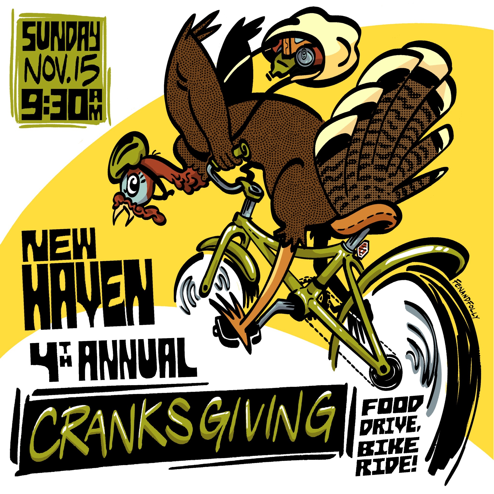
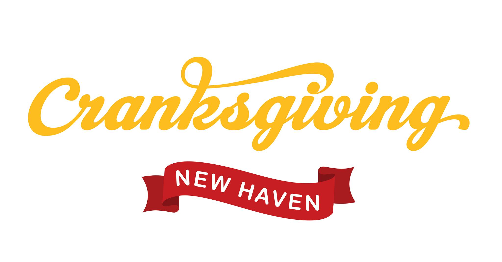

# Cranksgiving 2026

Cranksgiving is a food drive for charity on two wheels. Part bike ride, part scavenger hunt. All you need is a bicycle, a lock and a bag!

Cranksgiving 2026 will be taking place **November 15**.

Please plan to arrive at **9:30 AM**.

The group will **leave from the New Haven Green (flagpole) at 10:00 AM** and people should try to **be back at DESK by 1:30 PM**. There will be volunteers at DESK around until 2 PM.

Please join the [Signal group](https://signal.group/#CjQKIKYjbrY4Q5FfuQNZTDJzXlAFjsC0PNxeyzCZ6i70SMN4EhC8KlrR5ipepOG15loXPxLY) so you can get push notifications about the event, any important information will also be published to the website.

Joining the signal group will also give us a good idea for the turnout and it will help us out a lot with organizing.

This event is FREE, but you'll need $30-$40 to purchase food. Donations will support Downtown Evening Soup Kitchen.

Bike out to nearby grocery stores to pick up non-perishables that will support DESK [<https://www.deskct.org/>](https://www.deskct.org).

Cranksgiving is a national event that occurs in over 100 cities across the United States and Canada. Visit [https://cranksgiving.org/](https://cranksgiving.org/) for more locations.

## The ride

The easiest way to stick to the planned route is to group up and follow someone with a bike computer.

A link will be provided which can be opened on mobile devices and a cue sheet will also be available.

Route will be provided publicly the night before the event.

## Priority food donation list

Bread (for Stuffing)
Yellow Onions
Carrots
Celery
Butternut Squash
Brussels Sprouts
Yukon Gold Potatoes

## Acknowledgements

Thank you to all the volunteers of previous events.

Thank you to the volunteers and organizers at DESK CT.

We would also like to remember, in loving memory, a volunteer and member of the volunteering community, Martin, and keep his family in our hearts.

